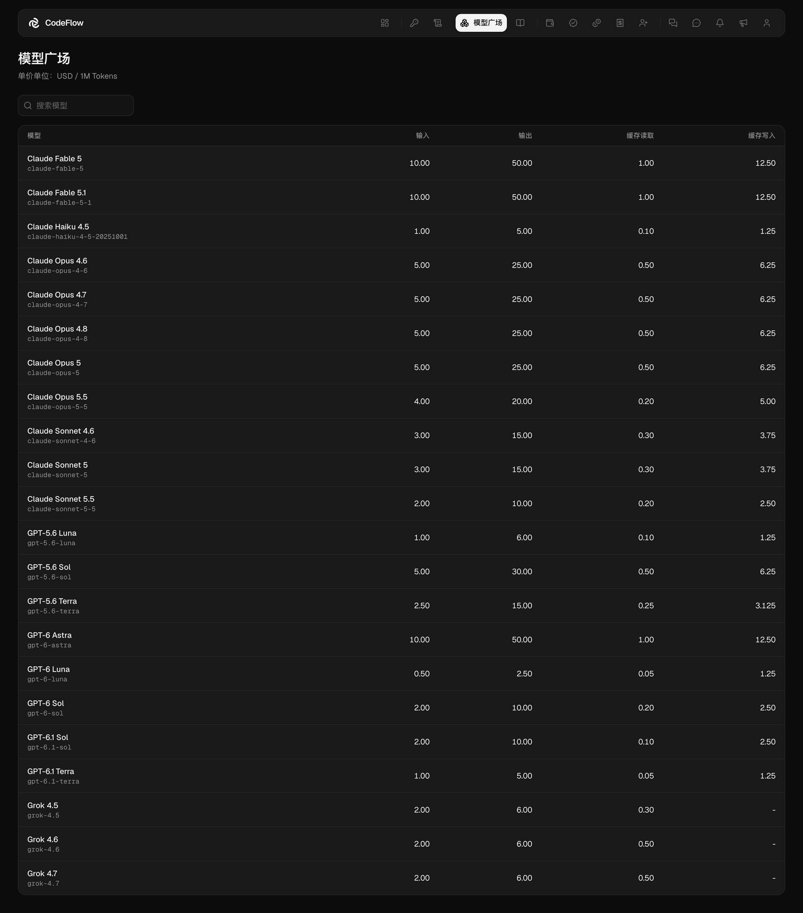
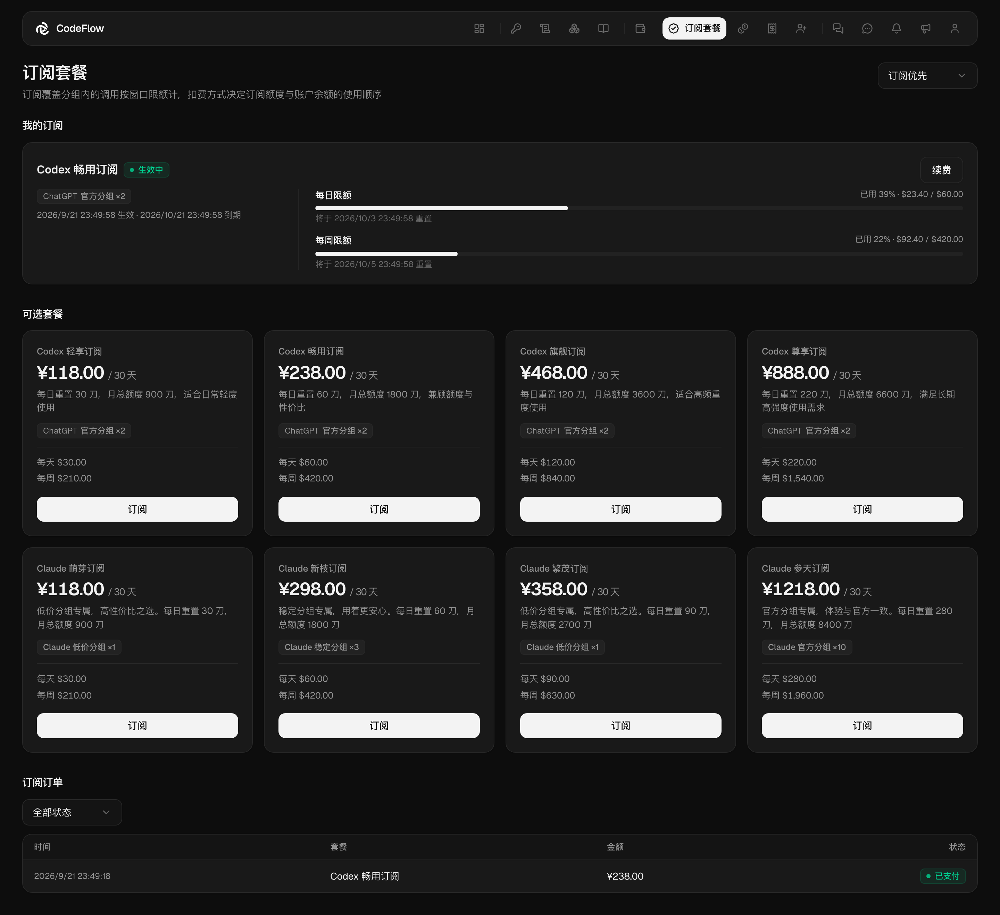

# 模型与计费

> **数据来源与核验**
>
> - **来源**：[{{SITE_NAME}}「模型广场」]({{SITE_URL}}/#pricing) 与登录后的[控制台「订阅套餐」]({{SITE_URL}}/subscription)
> - **核验范围**：模型列表、模型 ID 与单价（含长上下文阶梯价），订阅套餐的名称、价格、覆盖分组与额度，「扣费方式」选项、预扣规则与额度流水类型
> - **最后核验日期**：2026 年 11 月 7 日

本页说明模型单价的公示位置、按量计费与订阅套餐两种计费方式，以及预扣结算、长上下文与缓存计费规则。模型可用性、单价和套餐可能调整，使用前以站点实时显示为准

## 模型广场

模型单价由 **模型广场** 公示。登录后在 **模型广场** 点开模型，可查看该模型上架的分组及各分组的实时可用性、近 24 小时调用统计、各档单价与分组价格；OpenAI 或 Anthropic 官方状态页有未解决的事件时，搜索栏右端会显示对应的官方状态（如「事件处理中」「部分降级」），点击可打开官方状态页

> **配置说明**
>
> 上图已按 2026 年 11 月 7 日公示的模型列表与单价更新，此后上下架的模型以 **模型广场** 实时显示为准

**模型广场** 中的单价单位为美元／百万 Token。各类 Token 费用按「该类计费用量 ÷ 1,000,000 × 对应单价」计算，输入、输出、缓存读取和缓存写入分别计价。**实际扣费 = 各类 Token 费用之和 × 令牌所在分组的计费倍率**，各分组的倍率见[分组与计费倍率](/guides/access.md#分组与计费倍率)。部分模型还会对特定请求参数另设倍率，命中时 Token 费用再乘以该倍率，多条命中依次相乘；**使用日志** 的调用详情会分别显示分组倍率、参数倍率与总倍率。最终扣费结果以控制台 **额度流水** 为准

### 长上下文计费

部分模型按单次请求的输入 Token 数分为 **基础** 与 **扩展** 两档单价：输入不超过阈值时按基础档计费，超过阈值时按扩展档计费。登录后在 **模型广场** 点开模型即可查看各档单价。核验时设有扩展档的模型如下，单位为美元／百万 Token，未计入分组倍率：

|模型 ID|扩展档条件|输入|输出|缓存读取|缓存写入|
|---|---|---|---|---|---|
|`claude-haiku-5-5`|输入超过 100k|0.50|2.50|0.05|0.625|
|`gpt-5.6-luna`|输入超过 272k|2.00|9.00|0.20|2.50|
|`gpt-5.6-sol`|输入超过 272k|10.00|45.00|1.00|12.50|
|`gpt-5.6-terra`|输入超过 272k|5.00|22.50|0.50|6.25|
|`gpt-6-astra`|输入超过 272k|20.00|75.00|2.00|25.00|
|`gpt-6-luna`|输入超过 272k|1.00|3.75|0.10|2.50|
|`gpt-6-sol`|输入超过 272k|4.00|15.00|0.40|5.00|
|`gpt-6.1-sol`|输入超过 272k|4.00|15.00|0.20|5.00|
|`gpt-6.1-terra`|输入超过 272k|2.00|7.50|0.10|2.50|
|`grok-4.5`|输入超过 200k|4.00|12.00|0.60|-|
|`grok-4.6`|输入超过 200k|4.00|12.00|1.00|-|
|`grok-4.7`|输入超过 200k|4.00|12.00|1.00|-|

基础档单价即 **模型广场** 列表中显示的单价

## 计费方式

**按量计费**：按实际 Token 用量从账户余额扣除。根据核验时的页面说明，账户余额长期有效；如规则调整，以充值页和控制台说明为准

**订阅套餐**：订阅期内按窗口额度调用，走订阅额度的调用不消耗账户余额；先扣订阅额度还是账户余额由 **扣费方式** 决定

> **注意**
>
> 套餐额度每日重置，并同时展示每周和每月总额度。具体恢复时间、统计窗口和未使用额度的处理方式，以登录后的 **订阅套餐** 页面为准

**订阅套餐** 页头右侧提供 **扣费方式** 下拉选项，默认为 **订阅优先**。四种方式的含义如下：

|扣费方式|说明|
|---|---|
|订阅优先|有可用订阅时使用订阅额度，订阅用尽或未覆盖当前分组时改扣余额|
|余额优先|余额充足时扣余额，余额不足时改用订阅额度|
|仅订阅|只使用订阅额度，订阅用尽或未覆盖当前分组时拒绝请求|
|仅余额|只扣账户余额，不使用订阅额度|

「未覆盖当前分组」指令牌所在分组不在任何有效订阅的覆盖范围内。订阅额度用尽而当前方式又不改扣余额时，请求会被拒绝，并在响应中给出恢复时间

生效中的订阅可在 **我的订阅** 中点击 **续费**，续费按套餐当前价格与时长在原到期时间上顺延

## 预扣与额度流水

**额度流水** 记录账户额度变动，类型包括充值、预扣、预扣退回、消费、退款、退款返还、奖励与管理员调整

调用发起后，系统先按本次请求估算一笔预扣：以估算的输入 Token 数加上请求声明的最大输出 Token 数，按输入单价与分组倍率计算；未声明最大输出时只按输入估算。调用结束后按实际用量结算，实际费用低于预扣则退回差额，高于预扣则追加一笔消费。单次调用的完整记录形式如下：

|时间|类型|变动|
|---|---|---|
|08:14:32|预扣|-$0.412500|
|08:14:33|预扣退回|+$0.080904|

上例中，两笔流水的净扣减额为 $0.331596。**额度流水** 中的请求 ID 可与 **使用日志** 中的具体调用对应，用于核对用量和扣费

上游未返回用量数据时，本次费用按请求与响应的文本量估算；既未返回用量也没有输出内容的调用不计费

> **注意**
>
> 可用余额低于本次预扣额时无法发起调用，即使最终费用更低；客户端声明的最大输出越大，单次预扣也越大。规则如有调整，以控制台返回信息为准

## 缓存计费

**模型广场** 分别列出 **缓存读取** 与 **缓存写入** 单价。缓存读取单价多为输入单价的十分之一，也有模型更低或更高，以 **模型广场** 为准；缓存写入显示为 `-` 表示该模型未设缓存写入单价。部分客户端和模型支持复用上下文缓存；命中缓存时，相关输入会按缓存读取价格计费

缓存行为取决于客户端、模型和上游实现，不能保证每次请求都命中。同一任务保持在连续会话中，通常更有利于复用已有上下文
